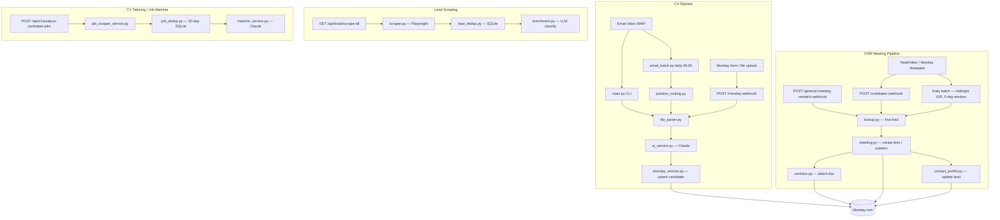

# Recruitment AI Backend

A Python backend that connects **Monday.com**, **Claude (Anthropic)**, and optional **email** / **meeting-note** / **job-board** sources for a recruitment agency workflow. It does four related jobs:

1. **CV pipeline** — When a candidate uploads a CV (via email or a Monday form), the server extracts structured profile data with AI and writes it back to Monday boards. Email CVs can be routed to active job boards by subject-line matching.
2. **CRM meeting pipeline** — When a meeting is recorded (via NodeTaker / Monday Notetaker), the server creates meeting notes on a CRM board, links them to leads, and attaches a Workdoc with the full summary.
3. **Lead scraping** — Scrapes Israeli job boards (including card snippets), filters blocked companies and hardware roles, classifies openings into 12 categories with an LLM, and returns sheet-ready JSON via HTTP.
4. **CV Tailoring & Job Matcher** — For n8n: scrapes the same Israeli boards (30-day URL dedup), then scores a candidate against openings with Claude (Wide Funnel), returning threshold-passing matches with CV version pick and Hebrew cover pitch.

All systems share Monday API helpers and run from the same FastAPI app in production.

---

## Table of contents

- [Big picture](#big-picture)
- [How to run](#how-to-run)
- [Environment variables](#environment-variables)
- [API endpoints](#api-endpoints)
- [System 1: CV pipeline](#system-1-cv-pipeline)
- [System 2: CRM meeting pipeline](#system-2-crm-meeting-pipeline)
- [System 3: Lead scraping](#system-3-lead-scraping)
- [System 4: CV Tailoring & Job Matcher](#system-4-cv-tailoring--job-matcher)
- [Project structure (file by file)](#project-structure-file-by-file)
- [Tests](#tests)
- [Deployment](#deployment)

---

## Big picture



| Entry point              | When to use it                                                                   |
| ------------------------ | -------------------------------------------------------------------------------- |
| `app.py` (via `uvicorn`) | Production server: webhooks, health check, scheduled CRM + email CV + status jobs |
| `run.py`                 | Local Windows-friendly server with reload (`127.0.0.1:8000`)                     |
| `main.py`                | One-off CLI: poll today's email inbox and process CV attachments                 |
| `docker compose up`      | Production stack: API + Caddy HTTPS + n8n + Dozzle                               |

---

## How to run

### Prerequisites

- Python 3.11+ recommended
- A `.env` file in the project root (see [Environment variables](#environment-variables); template: `.env.example`)
- For lead scraping: Playwright Chromium (`playwright install chromium`)

### Install dependencies

```bash
pip install -r requirements.txt
playwright install chromium
```

### Start the web server (local)

```bash
# Cross-platform
uvicorn app:app --host 0.0.0.0 --port 8000

# Windows (sets Proactor event-loop policy for Playwright, reload enabled)
python run.py
```

This starts FastAPI with:

- CV webhook at `POST /monday-webhook`
- Job-fit webhook at `POST /monday-job-fit-webhook` (job boards only)
- Exam → Hub webhook at `POST /monday-exam-webhook` (מבחנים)
- CRM webhook at `POST /nodetaker-webhook`
- General-meeting rematch at `POST /general-meeting-rematch-webhook`
- Lead scrape endpoints under `/api/leads/*`
- Matcher endpoints under `/api/v1/*` (scrape-test, single-job match, batch candidate→jobs)
- Supplier invoice batch at `POST /api/invoices/trigger-batch`
- A **Notetaker batch** at **00:00** Asia/Jerusalem (past **5 days** of meetings)
- A **morning briefing cron** at **07:00** Asia/Jerusalem
- A **daily email CV batch** at **08:00** Asia/Jerusalem (IMAP → position routing → Main Hub / job boards)
- An optional **daily supplier invoice cron** at **07:30** Asia/Jerusalem by default (when `ENABLE_SUPPLIER_INVOICE_CRON=true`; hour/minute via `SUPPLIER_INVOICE_CRON_HOUR` / `SUPPLIER_INVOICE_CRON_MINUTE`)
- A **weekly status email** on **Sunday 09:00** Asia/Jerusalem

### Run with Docker Compose (production-style)

```bash
docker compose up -d --build
```

Services:

| Service               | Role                                              |
| --------------------- | ------------------------------------------------- |
| `recruitment-backend` | FastAPI app on port 8000 (internal)               |
| `caddy`               | HTTPS reverse proxy (`api.beyondtcode.com`)       |
| `n8n`                 | Workflow automation (`n8n.beyondtcode.com`)       |
| `dozzle`              | Container log viewer on host port **8888**        |

### Run email CV ingestion (CLI)

```bash
python main.py
```

Polls the configured IMAP inbox for **all messages from today** (read and unread), applies strict CV attachment filtering, routes by subject to active job boards when possible, and upserts candidates.

### Email ingestion behavior

The scheduled job (`app.py`, 08:00) and CLI (`main.py`, today only) share `services/email_batch.py`:

1. **Lookback window** — scheduler scans all emails from the past ~24 hours (`date_gte=yesterday`); CLI scans today only.
2. **No UNSEEN dependency** — read and unread messages are both included; `\Seen` is not used for filtering or dedup.
3. **Attachment filtering** — only `.pdf` / `.docx` with valid magic bytes, minimum 2 KB size, and non-denylisted filenames.
4. **CV content validation** — minimum text length and keyword heuristics before Claude; schema validation failures count as skipped, not errors.
5. **Position routing** — email subject/body is matched against active positions on the Position Requests board; matched CVs go to the corresponding job board (plus Main Hub sync). Unmatched CVs go to Main Hub only.
6. **Deduplication** — `Message-ID` + SHA-256 state file (7-day retention) avoids re-processing the same attachment; Main Hub upsert by email/phone updates existing profiles instead of creating duplicates.

### Health check

```bash
curl http://localhost:8000/health
```

---

## Environment variables

Create a `.env` file. Variables are grouped by which system needs them.

### Shared / CV pipeline

| Variable                | Required | Purpose                                                  |
| ----------------------- | -------- | -------------------------------------------------------- |
| `ANTHROPIC_API_KEY`     | Yes (CV) | Claude API key for CV extraction                         |
| `ANTHROPIC_MODEL`       | No       | Model name (default: `claude-sonnet-4-6`)                |
| `MONDAY_API_KEY`        | Yes      | Monday.com API token                                     |
| `MONDAY_BOARD_ID`       | Yes (CV) | **Main Hub** board ID — central candidate board          |
| `MONDAY_FILE_COLUMN_ID` | No       | Column ID for CV file uploads (default: `file_mm3gnkmj`) |
| `MONDAY_GROUP_ID`       | No       | Group for new items (default: `topics`)                  |

### Exam board → Hub (`POST /monday-exam-webhook`)

| Variable                                  | Required | Purpose                                                                 |
| ----------------------------------------- | -------- | ----------------------------------------------------------------------- |
| `MONDAY_EXAM_BOARD_ID`                    | No       | מבחנים board ID (default: `5097679903`)                                 |
| `MONDAY_EXAM_TO_HUB_RELATION_COLUMN_ID`   | No       | Exam Connect → Hub (default: `board_relation_mm3xpjrx`)                 |
| `MONDAY_HUB_TO_EXAM_RELATION_COLUMN_ID`   | No       | Hub Connect → Exam (default: `board_relation_mm3xds1f`)                 |

### Email ingestion (scheduled job + CLI)

| Variable         | Required    | Purpose              |
| ---------------- | ----------- | -------------------- |
| `EMAIL_HOST`     | Yes (email) | IMAP server hostname |
| `EMAIL_USER`     | Yes (email) | IMAP username        |
| `EMAIL_PASSWORD` | Yes (email) | IMAP password        |

Required for the **08:00 daily email CV batch** in `app.py` and for manual runs via `main.py`. If unset, the scheduled job logs a warning and skips without crashing the server.

### Weekly status email

| Variable            | Required     | Purpose                                      |
| ------------------- | ------------ | -------------------------------------------- |
| `GMAIL_APP_PASSWORD`| Yes (status) | Gmail app password for Sunday health-check email |

### Lead scraping (`/api/leads`)

| Variable          | Required | Purpose                                                                 |
| ----------------- | -------- | ----------------------------------------------------------------------- |
| `LEADS_SCRAPE_URL`| No       | Default job-board listing URL for `GET /api/leads/scrape`               |
| `LEADS_DEDUP_DB`  | No       | Path to SQLite seen-jobs DB (default under project data dir)            |
| `OPENAI_API_KEY`  | No       | Optional OpenAI key for enrichment when Anthropic is unavailable        |
| `OPENAI_MODEL`    | No       | OpenAI model for enrichment (used only if OpenAI path is selected)      |

Enrichment prefers Anthropic (`ANTHROPIC_API_KEY`); falls back to OpenAI when configured.

### Matcher job scraping (`/api/v1`)

| Variable         | Required | Purpose                                                                 |
| ---------------- | -------- | ----------------------------------------------------------------------- |
| `JOBS_DEDUP_DB`  | No       | SQLite path for matcher seen-jobs store (default: `data/jobs.db`)       |
| `JOBS_DEDUP_DAYS`| No       | Days a job URL stays “seen” before it can surface again (default: `30`) |

Uses `ANTHROPIC_API_KEY` / `ANTHROPIC_MODEL` for match scoring. Separate from lead-scrape dedup (`LEADS_DEDUP_DB`).

### CRM meeting pipeline (`crm_integration/`)

| Variable                                             | Required  | Purpose                                    |
| ---------------------------------------------------- | --------- | ------------------------------------------ |
| `MONDAY_CRM_LEADS_BOARD_ID`                          | Yes (CRM) | Board ID for leads (all CRM contacts)      |
| `MONDAY_CRM_LEADS_EMAIL_COLUMN_ID`                   | Yes (CRM) | Email column on leads board                |
| `MONDAY_CRM_LEADS_ADDITIONAL_EMAILS_COLUMN_ID`       | No        | Extra emails column on leads (default: `text_mm57t6sd`) |
| `MONDAY_CRM_LEAD_SUBITEMS_BOARD_ID`                  | No        | Subitems board for lead meeting summaries (default: `5099504229`) |
| `MONDAY_CRM_LEAD_SUBITEM_DATE_COLUMN_ID`             | No        | Meeting date on lead subitems (default: `date_mm4ze64m`) |
| `MONDAY_CRM_LEAD_SUBITEM_SUMMARY_COLUMN_ID`          | No        | Summary intro on lead subitems (default: `long_text_mm4z4xk7`) |
| `MONDAY_CRM_LEAD_SUBITEM_ACTION_ITEMS_COLUMN_ID`     | No        | Action items on lead subitems (default: `long_text_mm4zmww8`) |
| `MONDAY_CRM_LEAD_SUBITEM_DOC_COLUMN_ID`              | No        | Workdoc column on lead subitems (default: `doc_mm4zfavw`) |
| `MONDAY_CRM_LEAD_SUBITEM_EXTERNAL_PARTICIPANTS_COLUMN_ID` | No   | External participant emails on subitems (default: `text_mm50eccx`) |
| `MONDAY_CRM_LEAD_SUBITEM_PEOPLE_COLUMN_ID`           | No        | Internal participants on subitems (default: `multiple_person_mm4z8qfq`) |
| `MONDAY_CRM_LEAD_SUBITEM_REMINDER_DATE_COLUMN_ID`    | No        | Mirly reminder date on subitems (default: `date_mm4zevqa`) |
| `MONDAY_CRM_LEAD_SUBITEM_REMINDER_INFO_COLUMN_ID`    | No        | Mirly reminder info on subitems (default: `long_text_mm4z3gp2`) |
| `MONDAY_CRM_MEETING_NOTES_BOARD_ID`                  | No        | Legacy meeting notes board (optional)      |
| `MONDAY_CRM_MEETING_NOTES_GROUP_ID`                  | No        | Group for new meetings (default: `topics`) |
| `MONDAY_CRM_COMPANY_MEETINGS_BOARD_ID`               | No        | Board for internal / general meetings (default: `5099503871`) |
| `MONDAY_CRM_COMPANY_MEETINGS_GROUP_ID`               | No        | Group for company meetings (default: `topics`) |
| `BEYONDCODE_COMPANY_CLIENT_ITEM_ID`                   | No        | BeyondCode lead item for company meeting relations (default: `3018755375`) |
| `BEYONDCODE_COMPANY_CLIENT_NAME`                     | No        | Fallback lead name lookup on Leads board |
| `MONDAY_CRM_MEETING_DATE_COLUMN_ID`                  | Yes (CRM) | Date column on company meeting board       |
| `MONDAY_CRM_MEETING_LEAD_RELATION_COLUMN_ID`         | No        | Board relation → lead (company meetings)   |
| `MONDAY_CRM_MEETING_DOC_COLUMN_ID`                   | Yes (CRM) | Column that holds the Workdoc (company meetings) |
| `MONDAY_CRM_MEETING_SUMMARY_COLUMN_ID`               | Yes (CRM) | Short summary text column                  |
| `MONDAY_CRM_MEETING_EXTERNAL_PARTICIPANTS_COLUMN_ID` | No        | External participant emails                |
| `MONDAY_CRM_MEETING_ACTION_ITEMS_COLUMN_ID`          | No        | Action items text column                   |
| `MONDAY_CRM_MEETING_TYPE_COLUMN_ID`                  | No        | Meeting type dropdown                      |
| `MONDAY_CRM_MEETING_PEOPLE_COLUMN_ID`                | No        | Internal participants on company meetings  |
| `FUTURE_MEETINGS_BOARD_ID`                           | No        | Morning-briefings board (default: `5098793829`) |
| `MIRLY_REMINDERS_BOARD_ID`                           | No        | Mirly reminders board (default: `5099196766`) |
| `MONDAY_NOTEAKER_API_KEYS`                           | No        | Comma-separated Notetaker tokens (one per teammate); falls back to `MONDAY_API_KEY` |

### Supplier invoice trigger (n8n)

| Variable                         | Required     | Purpose                                                                 |
| -------------------------------- | ------------ | ----------------------------------------------------------------------- |
| `N8N_INVOICE_WEBHOOK_URL`        | Yes (batch)  | n8n Webhook URL; each trigger posts `{"supplier_email": "..."}`         |
| `INVOICE_BATCH_CONCURRENCY`      | No           | Max concurrent webhook POSTs (default: `10`; `0` = unlimited)           |
| `INVOICE_BATCH_DELAY_SECONDS`    | No           | Optional stagger between webhook starts in seconds (default: `0`)       |
| `MONDAY_SUPPLIERS_BOARD_ID`      | Yes (Monday) | Suppliers board used when the request body has no emails                |
| `MONDAY_SUPPLIER_EMAIL_COLUMN_ID`| No           | Email column on suppliers board (default: `email_mm5fbcxc`)             |
| `ENABLE_SUPPLIER_INVOICE_CRON`   | No           | If `true`, run daily batch in Asia/Jerusalem (default: off)             |
| `SUPPLIER_INVOICE_CRON_HOUR`     | No           | Daily cron hour 0–23 (default: `7`)                                     |
| `SUPPLIER_INVOICE_CRON_MINUTE`   | No           | Daily cron minute 0–59 (default: `30`)                                  |

If `N8N_INVOICE_WEBHOOK_URL` is unset, the batch logs a warning and skips. See `.env.example` for a full template.

---

## API endpoints

| Method   | Path                              | Purpose                                                              |
| -------- | --------------------------------- | -------------------------------------------------------------------- |
| `GET`    | `/health`                         | Liveness check — returns `{"status": "ok", ...}`                     |
| `POST`   | `/monday-webhook`                 | Monday.com webhook for CV processing                                 |
| `POST`   | `/monday-job-fit-webhook`         | Monday.com webhook for job-fit scoring on job boards (no Hub sync)   |
| `POST`   | `/monday-exam-webhook`            | Exam board (מבחנים) → Hub upsert + bidirectional Connect links       |
| `POST`   | `/nodetaker-webhook`              | NodeTaker webhook for meeting → CRM                                  |
| `POST`   | `/general-meeting-rematch-webhook`| Rematch a General Meetings item to a lead by participant emails      |
| `GET`    | `/api/leads/scrape`               | Scrape one job-board URL and return enriched leads                   |
| `GET`    | `/api/leads/scrape-all`           | Run all lead searches (~3-day window), filter, classify, return new leads |
| `DELETE` | `/api/leads/dedup`                | Clear SQLite seen-jobs table so scrape treats all links as new       |
| `GET`    | `/api/v1/jobs/scrape-test`        | Manually scrape boards and preview newly seen matcher jobs           |
| `POST`   | `/api/v1/analyze-match`           | Score one candidate against one job (`MatchAnalysis`)                |
| `POST`   | `/api/v1/analyze-candidate-jobs`  | Scrape daily jobs → prefilter → score; return threshold matches      |
| `POST`   | `/api/invoices/trigger-batch`     | Queue concurrent n8n supplier-invoice triggers (`202 Accepted`)      |
| `GET`    | `/test-fetch-sarah`               | **Dev only** — manually fetch a test meeting and run CRM pipeline    |

### `POST /api/invoices/trigger-batch`

Accepts an optional JSON body and returns **202 Accepted** immediately; work runs in a FastAPI background task:

```json
{
  "emails": ["vendor@example.com", "other@example.com"]
}
```

- If `emails` is omitted or empty, supplier emails are loaded from `MONDAY_SUPPLIERS_BOARD_ID`.
- Each unique email is POSTed concurrently to `N8N_INVOICE_WEBHOOK_URL` as `{"supplier_email": "..."}` (concurrency via `INVOICE_BATCH_CONCURRENCY`; optional start stagger via `INVOICE_BATCH_DELAY_SECONDS`).

### `POST /api/v1/analyze-match`

Scores one candidate against one job. Example body:

```json
{
  "candidate": {
    "profile_text": "Full-stack engineer, React + Node, 5 years...",
    "available_cv_files": ["cv_fullstack_en.pdf", "cv_backend_he.pdf"]
  },
  "job": {
    "id": "abc123",
    "title": "Senior Full Stack Developer",
    "company": "Acme",
    "description": "Looking for...",
    "url": "https://example.com/jobs/1"
  }
}
```

Returns `MatchAnalysis`: `match_score` (0–100), `passed_threshold` (≥ **60**), optional `selected_cv_version` / Hebrew `cover_pitch`, plus job identity fields and `apply_url`.

### `POST /api/v1/analyze-candidate-jobs`

n8n-oriented batch path: scrapes Israeli boards (30-day dedup), keyword-prefilters up to **15** jobs, then scores them in parallel with Claude. Only matches with `match_score >= 60` are returned.

```json
{
  "candidate": {
    "profile_text": "...",
    "available_cv_files": ["cv_fullstack_en.pdf"]
  },
  "candidate_email": "candidate@example.com"
}
```

### `GET /api/v1/jobs/scrape-test`

Manual scrape preview for matcher jobs (`total_found`, `new_jobs_count`, `jobs[]`). Marks newly seen URLs in `JOBS_DEDUP_DB`.

### `POST /monday-webhook`

Triggered by Monday when:

- A new item is created (`create_pulse` / `create_item`) — e.g. form submission, or
- A **file column** changes (`change_column_value` where `columnId` starts with `file_`)

Flow:

1. Respond immediately with `{"status": "success"}` (work runs in the background).
2. Download the CV file from the Monday item.
3. Extract text → send to Claude → upsert candidate fields on the source board.
4. If the source board is not the Main Hub, also sync to the Main Hub board.
5. On job boards, fetch דרישות משרה and write `job_fit_score` / `job_fit_reasoning` when applicable.

Monday URL verification: if the body contains `"challenge"`, the server echoes it back.

### `POST /monday-job-fit-webhook`

Dedicated job-fit path for **per-job boards** (not Main Hub). Same Monday payload shapes as `/monday-webhook` (`create_item` / `create_pulse`, file-column change, or custom-app `inputFields`).

Flow:

1. Respond immediately with `{"status": "success"}` (work runs in the background).
2. Ignore Main Hub boards.
3. Require non-empty דרישות משרה on the board; otherwise skip with an error log.
4. Download the CV → Claude job-fit analysis → update the **source job-board item** only (`sync_to_hub=False`).

Point a Monday automation on job boards at this URL so scoring is independent of hub CV ingest.

### `POST /monday-exam-webhook`

Triggered when an item is created on the **מבחנים** (Exam) board (`MONDAY_EXAM_BOARD_ID`, default `5097679903`). Same Monday payload shapes as `/monday-webhook` (`create_item` / `create_pulse`, optional file-column change, or custom-app `inputFields`).

Flow:

1. Respond immediately with `{"status": "success"}` (work runs in the background).
2. Ignore boards other than the Exam board.
3. Read name / email / phone and context fields from the exam item.
4. If a CV file is attached, Claude-extract and upsert the Main Hub; otherwise upsert from exam fields only (no resume required).
5. Fold מקור מועמד / משרה / מסלול נבחן / exam notes into Hub הערות (`long_text_mm3g3yhw`).
6. Set Connect columns both ways: Exam `board_relation_mm3xpjrx` ↔ Hub `board_relation_mm3xds1f`.

Point a Monday automation on מבחנים “item created” at `https://api.beyondtcode.com/monday-exam-webhook`.

### `POST /nodetaker-webhook`

Expects JSON matching `NodeTakerWebhookPayload`:

```json
{
  "meeting_title": "Intro call with Acme",
  "meeting_date": "2026-06-17",
  "participant_emails": ["client@example.com", "dev@beyondtcode.com"],
  "meeting_summary": "Discussed hiring needs...",
  "action_items": "- Send JD\n- Schedule follow-up"
}
```

Flow: match participant emails to a lead → create a **subitem** under that lead with summary, date, participants, and action items → create a Workdoc on the subitem → Claude extracts a Hebrew company profile + latest meeting date → update the matched lead item on Monday (column IDs in `crm_integration/contact_profile.py`). Internal-only (Beyond Code) meetings still create rows on the company meetings board unchanged.

### `POST /general-meeting-rematch-webhook`

Accepts Monday webhook / custom-app payloads with an `item_id` (and optional `board_id`). When the item is on the **General / company meetings** board, re-reads participant emails, looks up a lead, and runs the same CRM enrichment path used for matched customer meetings. Ignores items from other boards. Echoes Monday `challenge` when present.

---

## System 1: CV pipeline

**Goal:** Turn a raw CV (PDF/DOCX) into structured candidate data on Monday.

### Step-by-step

```
CV arrives (email or Monday upload)
        ↓
[email path] position_routing.py — match subject to active job board
        ↓
utils/file_parser.py — extract plain text (handles PDF hyperlinks, DOCX headers)
        ↓
services/ai_service.py — Claude extracts fields into CandidateSchema
        ↓
services/monday_service.py — find existing item by email/phone or create new one
        ↓
Monday board updated (name, skills, city, summary, file, ecosystem columns, job-fit, etc.)
```

### Key behaviors

- **Upsert, not always create:** If a candidate with the same email or phone already exists on the board, the item is updated instead of duplicated.
- **Main Hub sync:** Webhook-triggered CVs are written to the triggering board *and* the Main Hub (`MONDAY_BOARD_ID`), unless the trigger already came from the Hub. Email CVs routed to a job board also sync to the Hub.
- **Position routing (email):** Active positions come from the Position Requests board (`גיוס פעיל`). Subject/body hints are scored against position names; score ≥ 60 routes to the matching Monday board.
- **Job-fit scoring:** On job boards, Claude scores candidates 1–10 against דרישות משרה (hard-requirement gate caps at 3/10 if any חובה fails). Score/reasoning columns are written on job boards only, not Main Hub.
- **AI rules are strict:** `ai_service.py` contains a long system prompt tuned for Israeli tech recruiting (city inference, Haredi sector, professional-only experience years, etc.). Post-processing sanitizers clear fields that must never come from CVs (`test_score`, `interview_summaries`).
- **Email path:** `email_batch.py` scans IMAP for PDF/DOCX CVs (read + unread), validates content, deduplicates via Message-ID + file hash and Main Hub email/phone upsert. Runs daily at **08:00** in `app.py` or manually via `main.py` (today only).

### Data model

`models/candidate.py` defines `CandidateSchema` — every field maps to a Monday column via `json_schema_extra.monday_id`. This is the contract between Claude's tool output and `monday_service.py`.

---

## System 2: CRM meeting pipeline

**Goal:** When a meeting is transcribed/summarized, automatically log it in Monday CRM and link it to the right contact.

### Step-by-step

```
Meeting data arrives (webhook, rematch, or Notetaker API batch)
        ↓
crm_integration/lookup.py — search Leads board by participant email (+ additional emails)
        ↓
crm_integration/meeting.py — create lead subitem and/or company / meeting-notes item
        ↓
crm_integration/workdoc.py — create Monday Workdoc with title, participants, summary, action items
        ↓
services/ai_service.py — extract_client_meeting_profile (JSON: profile + latest_date)
        ↓
crm_integration/contact_profile.py — update matched lead (AI profile, last contact, progress log)
```

### Ways meetings enter the system

1. **Real-time webhook** — `POST /nodetaker-webhook` (routed via `crm_integration/routes.py`).
2. **Daily batch** — APScheduler at **00:00 Asia/Jerusalem** (`app.py` → `crm_integration/batch.py` → `run_daily_notetaker_batch()`), covering the past **5 days**.
3. **General-meeting rematch** — `POST /general-meeting-rematch-webhook` when a company-meeting item should be re-linked to a lead.
4. **Morning briefings** — APScheduler at **07:00** (`process_morning_briefs`) for today's future-meetings board items.

### Contact matching

- Participant emails are normalized and deduplicated.
- Contacts are matched on the **Leads** board by primary email and the additional-emails column.
- Internal `@beyondtcode.com` addresses are filtered out when storing external participants.
- If no external match is found but an internal participant was present, the pipeline can fall back to the BeyondCode company meetings board.
- If no match is found, the meeting item may still be created — just without a board relation (path-dependent).

### Meeting type classification

`meeting.py` auto-labels meetings (e.g. "פגישת היכרות", "סגירה", "מצגת") based on keywords in the title and summary.

---

## System 3: Lead scraping

**Goal:** Find open roles in 12 categories on Israeli job boards, drop blocked companies and hardware roles, and return clean, sheet-ready rows over HTTP (n8n appends them to the leads sheet).

### Step-by-step

```
GET /api/leads/scrape-all   (n8n, every 2 days 08:00)
        ↓
services/job_sources.py — LEAD_SEARCHES (board, label, url), ~3-day window
        ↓
services/scraper.py — Playwright + BeautifulSoup listing scrape (+ card snippet),
                      lead title prefilter (services/lead_filters.passes_title_prefilter)
        ↓
services/lead_dedup.py — skip job links seen before (SQLite, data/seen_leads.db)
        ↓
services/lead_filters.py — blocked companies, hardware roles,
                           cross-board duplicates (company + title fingerprint)
        ↓
services/enrichment.py — LLM: category (one of 12, or none → dropped) + job summary
        ↓
JSON list of LeadOpportunity
```

Response keys match the sheet headers: **Company Name**, **Job Title**, **Category**, **Outreach Phrasing**, **Job Summary**, **Job Link**, **Publish Date** (DD/MM/YYYY), **Found Date**, **Source**.

Categories: Backend, Frontend, Full Stack, QA, פיתוח אוטומציה, יישום Salesforce, יישום monday.com, AI Builder, AI Workflow Builder, AI Automation Specialist, AI Implementation Specialist, AI Agent Developer. Outreach phrasing per category is in `lead_filters._PHRASING`.

Not collected: DevOps/SRE, data science, product, cyber, support, hardware (`hardware, chip design, firmware, קושחה, embedded, משובץ, driver, kernel, BSP` in title or snippet), and the 11 companies in `lead_filters.BLOCKED_COMPANIES` (SQLink is also no longer scraped).

Jobs whose LLM call fails are **not** marked as seen, so the next run retries them. The dedup store lives in `./data` (mounted as a Docker volume) so it survives rebuilds.

### Sources (`/scrape-all`)

LinkedIn, AllJobs, Drushim, JobMaster, Glassdoor, Jobnet — 22 searches covering development, QA/automation, Salesforce/monday.com and AI Builder roles. Failures on one search are logged and do not abort the others. The CV matcher (System 4) keeps its own `DEFAULT_SEARCH_URLS`.

### Dedup reset

```bash
curl -X DELETE http://localhost:8000/api/leads/dedup
```

---

## System 4: CV Tailoring & Job Matcher

**Goal:** Give n8n a lean HTTP API that scrapes fresh Israeli tech openings and scores a candidate against them (Wide Funnel), without Monday/email/Slack orchestration in this service.

### Step-by-step

```
POST /api/v1/analyze-candidate-jobs (or scrape-test / analyze-match)
        ↓
services/job_scraper_service.py — scrape DEFAULT_SEARCH_URLS via scraper.py
        ↓
services/job_dedup.py — keep URLs not seen in the last JOBS_DEDUP_DAYS (default 30)
        ↓
(optional) httpx detail-page description enrichment
        ↓
services/matcher_service.py — keyword prefilter (domain mismatch + relevance) → top 15
        ↓
Claude (AsyncAnthropic) — parallel match_score / CV pick / Hebrew cover_pitch
        ↓
BatchMatchResponse — only matches with score ≥ 60
```

### Key behaviors

- **Separate dedup from lead scraping** — matcher uses `data/jobs.db` (`JOBS_DEDUP_DB` / `JOBS_DEDUP_DAYS`); leads use `LEADS_DEDUP_DB`.
- **Wide Funnel scoring** — inclusive fit (55–75 for plausible gaps; 75–95 for strong fit); threshold **60** for `passed_threshold` and cover pitch.
- **Prefilter before LLM** — drops hard domain mismatches (e.g. embedded/hardware vs web candidate), ranks by tech-phrase overlap, caps at **15** jobs per batch.
- **Timeouts for n8n** — per-call LLM timeout ~15s, batch deadline ~40s, concurrency 5; soft-fails individual jobs.
- **No Monday writes** — analysis engine only; n8n owns downstream application / notification flow.

### Schemas

`schemas/matcher.py` defines `MatchRequest`, `MatchAnalysis`, `CandidateOnlyRequest`, `BatchMatchResponse`, `JobInput`, and `JobScrapeTestResponse`.

---

## Project structure (file by file)

```
recruitment-ai-backend/
├── app.py                  # FastAPI app — webhooks, scheduler, health
├── run.py                  # Local Windows-friendly uvicorn entry
├── main.py                 # CLI entry — email CV ingestion
├── requirements.txt        # Python dependencies
├── Dockerfile              # Python 3.11 + Playwright Chromium
├── docker-compose.yml      # API + Caddy + n8n + Dozzle
├── Caddyfile               # HTTPS reverse proxy routes
├── render.yaml             # Optional Render.com deployment config
│
├── core/
│   └── config.py           # Global settings (Anthropic key, model, Main Hub board ID)
│
├── models/
│   ├── __init__.py         # Re-exports CandidateSchema
│   └── candidate.py        # Pydantic schema for extracted candidate fields
│
├── schemas/
│   ├── __init__.py
│   └── matcher.py          # MatchRequest / MatchAnalysis / batch + scrape-test models
│
├── routers/
│   ├── leads.py            # GET /api/leads/scrape, /scrape-all, DELETE /dedup
│   ├── matcher.py          # /api/v1 scrape-test, analyze-match, analyze-candidate-jobs
│   └── invoices.py         # POST /api/invoices/trigger-batch
│
├── services/
│   ├── ai_service.py       # Claude CV extraction + meeting profile + sanitizers
│   ├── matcher_service.py  # Claude Wide Funnel job-match analysis (n8n)
│   ├── job_scraper_service.py # Board scrape + description enrich for matcher
│   ├── job_dedup.py        # SQLite 30-day seen-jobs store for matcher
│   ├── job_sources.py      # Shared DEFAULT_SEARCH_URLS for leads + matcher
│   ├── supplier_invoices.py # Monday supplier emails → concurrent n8n triggers
│   ├── cv_pipeline.py      # Shared CV flow used by email, webhook, and tests
│   ├── exam_pipeline.py    # Exam board → Hub upsert + Connect links
│   ├── email_batch.py      # Daily email CV batch, validation, dedup, position routing
│   ├── email_service.py    # IMAP: fetch PDF/DOCX attachments
│   ├── monday_service.py   # Monday GraphQL: upsert candidates, job-fit columns
│   ├── position_routing.py # Match email subjects to active job boards
│   ├── status_email.py     # Weekly Gmail health-check email
│   ├── scraper.py          # Playwright job-board scrapers
│   ├── enrichment.py       # LLM company/track classification for leads
│   └── lead_dedup.py       # SQLite seen-jobs store (leads API)
│
├── utils/
│   └── file_parser.py      # PDF/DOCX text extraction, URL download for Monday files
│
├── crm_integration/        # NodeTaker → Monday CRM (meetings, not CVs)
│   ├── __init__.py
│   ├── config.py           # CRM-specific Monday board/column IDs (CrmSettings)
│   ├── schemas.py          # NodeTakerWebhookPayload, NodeTakerWebhookResult
│   ├── routes.py           # /nodetaker-webhook, /general-meeting-rematch-webhook
│   ├── pipeline.py         # Orchestrates lookup → meeting → workdoc → profile
│   ├── rematch.py          # Re-link general meetings to leads
│   ├── lookup.py           # Find lead by participant email
│   ├── meeting.py          # Create meeting items/subitems, classify type
│   ├── workdoc.py          # Create and populate Monday Workdoc blocks
│   ├── contact_profile.py  # Update lead AI profile / last contact / progress
│   ├── monday_client.py    # GraphQL queries/mutations for CRM
│   ├── monday_fetcher.py   # Pull meetings from Monday Notetaker API
│   └── batch.py            # Daily Notetaker batch + morning briefings
│
└── test_*.py               # Unit/integration tests (see Tests section)
```

### Root files

| File                   | Role                                                                                                                                                                   |
| ---------------------- | ---------------------------------------------------------------------------------------------------------------------------------------------------------------------- |
| `**app.py**`           | Production server. Registers CRM + leads + matcher + invoices routers, handles `/monday-webhook`, starts APScheduler (notetaker 00:00, briefings 07:00, email CV 08:00, status email Sun 09:00, optional daily supplier invoices at 07:30 by default), exposes `/health` and a dev test endpoint. |
| `**run.py**`           | Local entrypoint with Windows Proactor loop policy and reload.                                                                                                         |
| `**main.py**`          | Standalone script: `process_email_cv_batch(lookback_days=0)` for same-day manual email CV ingestion.                                                                   |
| `**Dockerfile**`       | Slim Python 3.11 image with Playwright Chromium for scrapers.                                                                                                          |
| `**docker-compose.yml**` | Stack: backend, Caddy, n8n, Dozzle.                                                                                                                                  |
| `**Caddyfile**`        | Proxies `api.beyondtcode.com` → backend and `n8n.beyondtcode.com` → n8n.                                                                                               |
| `**requirements.txt**` | Dependencies: FastAPI, Anthropic/OpenAI SDKs, Playwright, BeautifulSoup, httpx, pypdf, python-docx, imap-tools, APScheduler, Pydantic, etc.                            |
| `**render.yaml**`      | Optional Render web service running `uvicorn app:app`.                                                                                                                 |

### `core/`

| File            | Role                                                                                                                       |
| --------------- | -------------------------------------------------------------------------------------------------------------------------- |
| `**config.py**` | Loads `ANTHROPIC_API_KEY`, `ANTHROPIC_MODEL`, `MONDAY_BOARD_ID` from `.env` via Pydantic Settings. Used by the CV/AI path. |

### `models/`

| File               | Role                                                                                                                                                                                                                                              |
| ------------------ | ------------------------------------------------------------------------------------------------------------------------------------------------------------------------------------------------------------------------------------------------- |
| `**candidate.py**` | Defines `CandidateSchema` (name, email, phone, city, job categories, programming languages, job-fit fields, etc.) and `ProgrammingLanguageExperience`. Each field documents its Monday column ID. |

### `services/`

| File                    | Role                                                                                                                                                                                                                                                                      |
| ----------------------- | ------------------------------------------------------------------------------------------------------------------------------------------------------------------------------------------------------------------------------------------------------------------------- |
| `**ai_service.py**`     | Sends CV text to Claude with a structured tool call. Validates against `CandidateSchema`, retries once on validation errors, then sanitizes output. Also extracts client meeting profiles and meeting progress summaries for CRM.                                          |
| `**matcher_service.py**`| Claude Wide Funnel match analysis for n8n: single-job and batch candidate→jobs (prefilter, concurrency, timeouts). No Monday/email orchestration. |
| `**job_scraper_service.py**` | Scrapes `DEFAULT_SEARCH_URLS`, applies matcher 30-day dedup, enriches descriptions, maps to `JobInput`. |
| `**job_dedup.py**`      | SQLite store of matcher seen job URLs (`JOBS_DEDUP_DB`, sliding `JOBS_DEDUP_DAYS` window). |
| `**job_sources.py**`    | Shared default Israeli board listing URLs used by lead scrape and matcher scrape. |
| `**cv_pipeline.py**`    | **Shared CV orchestrator.** `process_cv_bytes()` / `process_cv_file()` — parse → AI → Monday upsert. `process_monday_webhook()` — download file from Monday item first. Supports job-requirements context and low-confidence skip. |
| `**email_batch.py**`    | `process_email_cv_batch()` — IMAP fetch, text/CV validation, Message-ID + SHA-256 dedup, position routing, Main Hub / job-board upsert. Used by scheduler and `main.py`.                                                       |
| `**email_service.py**`  | Connects to IMAP, downloads validated PDF/DOCX from all messages in the lookback window to `temp_received_cvs/`. Does not mutate `\Seen`.                                                               |
| `**position_routing.py**` | Loads active recruiting positions, matches email subject/body hints to Monday job boards, resolves per-position job requirements.                                                                     |
| `**monday_service.py**` | Monday.com API for **candidates**: column mapping, dropdown resolution, file upload, email/phone upsert, job-fit columns, `post_graphql()` shared with CRM. |
| `**status_email.py**`   | Sends the weekly Hebrew health-check email via Gmail SMTP (`GMAIL_APP_PASSWORD`).                                                                                                                           |
| `**supplier_invoices.py**` | Loads supplier emails from Monday (or request body) and POSTs concurrently to n8n. |
| `**scraper.py**`        | Playwright-based scrapers for LinkedIn and Israeli job boards; captures listing-card snippet text for enrichment.                                                                                           |
| `**enrichment.py**`     | LLM classification of scraped jobs (company size filter, track A/B, tech-role filter, job summary, contact info).                                                                                            |
| `**lead_dedup.py**`     | SQLite store of seen job links for **lead-scrape** idempotency.                                                                                                                                                      |

### `utils/`

| File                 | Role                                                                                                                                                                |
| -------------------- | ------------------------------------------------------------------------------------------------------------------------------------------------------------------- |
| `**file_parser.py**` | Converts PDF/DOCX bytes to plain text. Preserves hidden hyperlinks (important for LinkedIn URLs). `download_cv_from_url()` fetches files from Monday's signed URLs. |

### `routers/`

| File              | Role                                                                 |
| ----------------- | -------------------------------------------------------------------- |
| `**leads.py**`    | Lead scraping HTTP API: scrape one URL, scrape-all, clear dedup DB. |
| `**matcher.py**`  | Matcher HTTP API under `/api/v1`: scrape-test, analyze-match, analyze-candidate-jobs. |
| `**invoices.py**` | Supplier invoice batch trigger: `POST /api/invoices/trigger-batch`. |

### `schemas/`

| File             | Role                                                                 |
| ---------------- | -------------------------------------------------------------------- |
| `**matcher.py**` | Pydantic models for matcher requests/responses (`MatchAnalysis`, etc.). |

### `crm_integration/`

| File                    | Role                                                                                                                                                                          |
| ----------------------- | ----------------------------------------------------------------------------------------------------------------------------------------------------------------------------- |
| `**config.py**`         | `CrmSettings` — all CRM board and column IDs from environment. Separate from `core/config.py` because CRM uses different boards.                                              |
| `**schemas.py**`        | Request/response models for the NodeTaker webhook.                                                                                                                            |
| `**routes.py**`         | FastAPI `APIRouter`: `POST /nodetaker-webhook`, `POST /general-meeting-rematch-webhook`.                                                                                      |
| `**pipeline.py**`       | `process_nodetaker_webhook()` — lookup contact → create meeting/subitem → workdoc → lead profile enrichment.                                                                  |
| `**rematch.py**`        | `process_general_meeting_rematch()` — rebuild payload from a company-meeting item and re-run CRM linking.                                                                     |
| `**lookup.py**`         | `find_contact_by_emails()` — queries Monday Leads board (primary + additional email columns).                                                                                 |
| `**meeting.py**`        | Builds column values, classifies meeting type, dedupes meetings, creates items/subitems, Mirly reminder columns, BeyondCode fallback.                                         |
| `**workdoc.py**`        | Creates a Monday Workdoc on the meeting item and inserts formatted blocks. Falls back to summary column if Workdoc creation fails.                                            |
| `**contact_profile.py**`| Updates lead AI profile text, last-contact date, and rolling meeting progress log.                                                                                            |
| `**monday_client.py**`  | CRM-specific GraphQL query/mutation strings and `execute_graphql()` — delegates to `services.monday_service.post_graphql`.                                                    |
| `**monday_fetcher.py**` | Reads from Monday's `notetaker.meetings` API. Used by the daily batch and the `/test-fetch-sarah` dev endpoint.                                                               |
| `**batch.py**`          | `process_recent_notetaker_meetings()` (5-day window) and `process_morning_briefs()`.                                                                                          |

### Temporary / generated (not source code)

| Path                             | Role                                                                     |
| -------------------------------- | ------------------------------------------------------------------------ |
| `temp_received_cvs/`             | Downloaded CV files and `.processed_attachments.json` dedup state; cleaned up after processing. |
| Lead dedup SQLite DB             | Seen job links for lead-scrape idempotency (`LEADS_DEDUP_DB` or default path). |
| Matcher dedup SQLite DB          | Seen job links for matcher (`JOBS_DEDUP_DB`, default `data/jobs.db`). |
| `.env`                           | Local secrets — **never commit**.                                        |
| `__pycache__/`, `.pytest_cache/` | Python/test caches — ignore.                                             |

Ad-hoc scripts in the repo root (`migrate_*.py`, `sync_*.py`, `run_5_day_backfill.py`, `sort_cv.py`, etc.) are one-off ops tools — not part of the production request path.

---

## Tests

Run all tests:

```bash
pytest
```

| Test file                       | What it covers                                                                                          |
| ------------------------------- | ------------------------------------------------------------------------------------------------------- |
| `test_crm_nodetaker_webhook.py` | CRM webhook, rematch, lookup, meeting classification, Workdoc, Notetaker fetch, morning briefs, profiles |
| `test_email_batch.py`           | Email attachment gate, CV text heuristics, hash dedup, batch summary stats                              |
| `test_position_routing.py`      | Subject hint extraction, active-position matching, board resolution                                     |
| `test_cv_pipeline.py`           | CV pipeline concurrency / shared orchestrator behavior                                                  |
| `test_pipeline.py`              | CV pipeline integration (file-driven)                                                                   |
| `test_ai_sanitize.py`           | AI output sanitizers (recruiter notes, test_score, job-fit clearing, etc.)                              |
| `test_file_parser.py`           | PDF/DOCX text extraction                                                                                |
| `test_monday_cv_file.py`        | Downloading CV files from Monday items                                                                  |
| `test_monday_upsert.py`         | Candidate upsert logic, column mapping, job-board requirements                                          |
| `test_webhook.py`               | Monday CV webhook parsing                                                                               |
| `test_exam_webhook.py`          | Exam → Hub webhook + no-CV field mapping / link scheduling                                              |
| `test_connection.py`            | Quick Monday API connectivity check                                                                     |

---

## Deployment

### Docker Compose (primary — Kamatera / VPS)

```bash
docker compose up -d --build
```

- **API:** `https://api.beyondtcode.com` (Caddy → `recruitment-backend:8000`)
- **n8n:** `https://n8n.beyondtcode.com`
- **Logs:** Dozzle on host port `8888`
- Mount a `.env` next to `docker-compose.yml` (loaded via `env_file`)

Point Monday webhooks at:

- CV processing → `https://api.beyondtcode.com/monday-webhook`
- Job-fit scoring (job boards) → `https://api.beyondtcode.com/monday-job-fit-webhook`
- Exam → Hub candidate sync → `https://api.beyondtcode.com/monday-exam-webhook`
- NodeTaker meetings → `https://api.beyondtcode.com/nodetaker-webhook`
- General meeting rematch → `https://api.beyondtcode.com/general-meeting-rematch-webhook`

### Render (optional)

`render.yaml` still deploys as a Render web service:

- **Build:** `pip install -r requirements.txt`
- **Start:** `uvicorn app:app --host 0.0.0.0 --port $PORT`
- Set required env vars in the Render dashboard. Note: Playwright-based lead scraping and persistent IMAP dedup state need extra setup on ephemeral disks.

---

## Quick mental model

| Question                            | Answer                                                                              |
| ----------------------------------- | ----------------------------------------------------------------------------------- |
| Where does the server run?          | `app.py` via uvicorn (Docker + Caddy in prod)                                       |
| How do CVs get in?                  | Email (daily 08:00 or `main.py`) or Monday upload (`/monday-webhook`)               |
| Where do email CVs land?            | Matched job board + Hub, or Hub only if no position match                           |
| Who reads the CV?                   | Claude in `ai_service.py`                                                           |
| Where does candidate data go?       | Monday boards via `monday_service.py`                                               |
| How do meetings get in?             | NodeTaker webhook, rematch webhook, or daily Notetaker batch (5 days)               |
| Where does meeting data go?         | Lead subitems + Workdoc (+ company meetings board for internal/general)             |
| How do new leads get discovered?    | `GET /api/leads/scrape` / `scrape-all` → scraper → enrichment                       |
| How does candidate↔job matching work? | `/api/v1/analyze-candidate-jobs` → job scrape + 30-day dedup → Claude Wide Funnel |
| What's shared between systems?      | `MONDAY_API_KEY`, `monday_service.post_graphql()`, Anthropic where applicable       |

If you're debugging **CV issues**, start at `app.py` or `main.py` → `email_batch.py` / `cv_pipeline.py` → `position_routing.py` / `ai_service.py` / `monday_service.py`.

If you're debugging **meeting/CRM issues**, start at `crm_integration/routes.py` or `batch.py` → `pipeline.py` → `lookup.py` / `meeting.py` / `workdoc.py` / `contact_profile.py`.

If you're debugging **lead scraping**, start at `routers/leads.py` → `scraper.py` → `lead_dedup.py` → `enrichment.py`.

If you're debugging **matcher / n8n matching**, start at `routers/matcher.py` → `job_scraper_service.py` / `job_dedup.py` → `matcher_service.py`.
